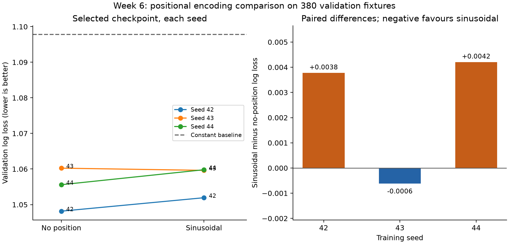
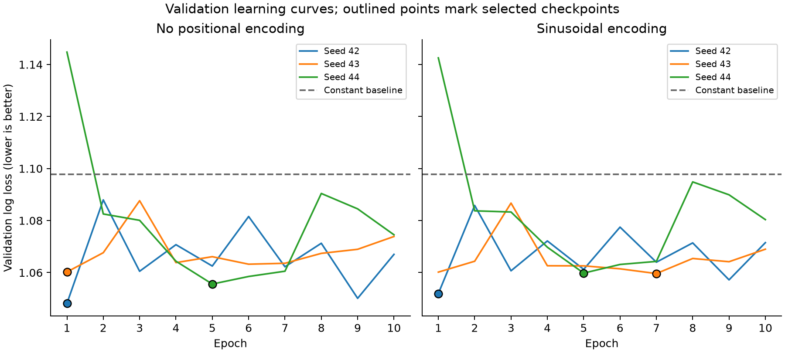

# Week 6 — results checkpoint

Team: Trivial  
Dara Heaphy — 23369914  
Tiernan Scully — 23365528

## Question and fixed experiment

Does fixed sinusoidal positional encoding improve next-fixture prediction compared with no positional encoding?

We compared no positional encoding with fixed sinusoidal encoding using seeds 42, 43 and 44 for both conditions. All six runs were trained fresh for this checkpoint. The seed set and protocol were saved before training. Each used ten epochs, Adam at 0.001, batch size 32, dropout 0.1, ten-match histories, CPU and one PyTorch thread. The shared one-layer transformer has 8,867 trainable parameters in both conditions. Only positional encoding changes within each seed pair.

The chronological splits contain 6,912 training, 380 validation and 357 reserved test examples. The lowest validation log loss selects each run's checkpoint. Results below are validation results used for development and checkpoint selection; final held-out evaluation has not been performed. There is no ensemble or best-seed selection.

## Individual results

Log loss uses natural logarithms; lower is better. Accuracy is secondary. Table log loss is independently recalculated from exported probabilities; tiny rounding differences from PyTorch cross-entropy are covered by the run verifier's tolerance.

| Condition | Seed | Selected epoch | Validation log loss | Accuracy | Training seconds |
| --- | ---: | ---: | ---: | ---: | ---: |
| none | 42 | 1 | 1.048161 | 47.63% | 11.45 |
| none | 43 | 1 | 1.060242 | 48.16% | 11.43 |
| none | 44 | 5 | 1.055596 | 47.11% | 11.17 |
| sinusoidal | 42 | 1 | 1.051936 | 48.16% | 11.26 |
| sinusoidal | 43 | 7 | 1.059625 | 47.63% | 11.35 |
| sinusoidal | 44 | 5 | 1.059801 | 46.32% | 12.11 |
| Training-frequency constant baseline | — | — | 1.097809 | 37.89% | — |

The constant predictor is fitted only to training class frequencies. It is a sanity baseline; the no-position transformer is the reference for the positional-information question.

## Variation and paired comparison

| Condition | Mean log loss | Sample SD | Range | Mean accuracy | Accuracy SD (percentage points) |
| --- | ---: | ---: | --- | ---: | ---: |
| none | 1.054666 | 0.006094 | 1.048161–1.060242 | 47.63% | 0.53 |
| sinusoidal | 1.057121 | 0.004491 | 1.051936–1.059801 | 47.37% | 0.95 |

Sample SD uses ddof=1 across three training seeds. It measures training variation on the same fixtures, not uncertainty across future seasons.

| Seed | Log-loss difference: sinusoidal − none | Accuracy difference (percentage points) |
| --- | ---: | ---: |
| 42 | +0.003775 | +0.53 |
| 43 | -0.000617 | -0.53 |
| 44 | +0.004206 | -0.79 |

Mean paired log-loss difference: **+0.002455**, sample SD **0.002669**. Negative favours sinusoidal encoding. Three runs do not establish statistical significance.



## Current interpretation

Sinusoidal encoding improved validation log loss for 1 of three seeds. The direction varies across seeds, so there is no consistent improvement in this comparison. A small mean difference should be interpreted alongside the paired variation.

Both conditions beat the constant baseline in every run.

The experiment tests whether this particular sinusoidal representation helps this small model. It does not directly test whether football recency is useful in every model. The no-position model ignores history order in evaluation; adding position allows order to matter but does not guarantee the model learns a useful recency rule.

## Anomalies and failure cases



Selected epochs: none seed 42: 1; none seed 43: 1; none seed 44: 5; sinusoidal seed 42: 1; sinusoidal seed 43: 7; sinusoidal seed 44: 5. The curves show whether later training improves validation loss. An early best checkpoint is an observation; it alone does not prove a particular cause such as overfitting.

### Draw predictions

| Condition | Seed | Actual draws | Predicted draws | Correct draws | Draw recall | Mean probability assigned to actual draws |
| --- | ---: | ---: | ---: | ---: | ---: | ---: |
| none | 42 | 83 | 0 | 0 | 0.00% | 0.2703 |
| none | 43 | 83 | 12 | 3 | 3.61% | 0.3010 |
| none | 44 | 83 | 0 | 0 | 0.00% | 0.2898 |
| sinusoidal | 42 | 83 | 0 | 0 | 0.00% | 0.2739 |
| sinusoidal | 43 | 83 | 0 | 0 | 0.00% | 0.2836 |
| sinusoidal | 44 | 83 | 2 | 0 | 0.00% | 0.2875 |

Draw predictions above mean the highest-probability class, not zero probability of a draw. Accuracy can obscure poor class recall; log loss still penalises the probability assigned to actual draws. Full class counts, recalls and class log losses are in `class_errors.csv`; each run retains its confusion matrix.

### Examples with the largest average log loss

These are validation fixtures ranked by mean individual-model log loss across all six selected checkpoints. They are selected examples, not an unbiased estimate of overall performance. Condition-level values are averages across its three seeds, not ensemble metrics.

| Fixture | Actual outcome | none: mean true-outcome probability | sinusoidal: mean true-outcome probability | Wrong seeds (none / sinusoidal) |
| --- | --- | ---: | ---: | --- |
| Manchester United vs Crystal Palace (578643) | away_win | 0.0647 | 0.0554 | 3 / 3 |
| Manchester United vs Sheffield United (578467) | away_win | 0.0901 | 0.0815 | 3 / 3 |
| Chelsea vs West Bromwich Albion (578369) | away_win | 0.0915 | 0.1002 | 3 / 3 |
| Manchester City vs Leicester City (578636) | away_win | 0.0971 | 0.1001 | 3 / 3 |
| Manchester City vs Leeds United (578355) | away_win | 0.1101 | 0.1044 | 3 / 3 |

The ten highest-loss cases, dates and condition-level losses are in `failure_cases.csv`. Inspect the underlying histories before attributing an error to a football-specific cause.

## Limitations and final evaluation

- Only three seeds and one validation season are available. Fixtures share teams and overlapping histories, so they are not independent observations.
- Each checkpoint is selected on this validation season; the reported validation results can be optimistic.
- Inputs contain goals scored, goals conceded and home status, but no team or opponent identity, injuries, squad changes or time gaps. Ten positions need not represent equal intervals of time.
- The small model, raw unscaled features and ten-epoch budget limit the conclusion to this setup.
- The final season has 367 unique completed fixtures and only 357 usable targets, not a full season.
- Future performance and betting value are not established by this experiment.

For Week 7, freeze the experiment and agree a final evaluation protocol before opening the test results. Retain all seeds; do not choose the best seed. The existing training and reporting commands produce no test predictions or metrics. The checkpoint's final held-out evaluation remains pending.

## Compute and verification

Six ten-epoch CPU runs, 8,867 parameters each. Total training/validation-loop time: 68.78 seconds. Runner wall time, including process startup and verification before reporting: 101.42 seconds. Training timings exclude preprocessing and evidence export. No GPU or paid compute was used.

Recorded processor: `AMD64 Family 25 Model 117 Stepping 2, AuthenticAMD`; 16 logical CPUs, one PyTorch thread. Python 3.14.2, PyTorch 2.14.0+cpu, Windows-11-10.0.26200-SP0.

An earlier packaging audit retained 6 additional full training runs (100.44 training-loop seconds). These used the same seeds and were excluded because the original source snapshot omitted the new comparison script imported by tests. After correcting the packager, all six main runs were repeated. This was a portability correction, not selection based on results. See `research/week6_packaging_audit/NOTE.md`.

All six checkpoints were reloaded and verified against their saved predictions. Independent Python metric calculations matched the training metrics within the recorded tolerances. The comparison also checked identical controlled settings, parameter counts, source/data hashes, environments, fixture order and baseline. See `checks.json` and each run's `verification.json`. Existing Week 5 repeats of seed 42 are not counted as independent runs in this study.

## Reproduction and evidence

In PowerShell, from `C:\Users\User\repos\AdvancedAIProject`:

```powershell
python -m pip install -r requirements-analysis.txt
python -m unittest discover -s tests -v
python comparison.py report --output research/week6
```

To train a fresh complete comparison without replacing this evidence:

```powershell
python comparison.py run --output research/week6_reproduction
```

A resumed `run` uses only its manifest's completed, verified runs. Failed or unlisted runs are not silently substituted. A report rejects incomplete or mismatched conditions. `python comparison.py bundle --output research/week6` creates an allowlisted ZIP including all six checkpoints, source snapshots, input CSV, reports, figures and SHA-256 manifest. Checkpoints and source snapshots remain ignored by Git, so retain the bundle or regenerate after cloning.

Run directories:

- `none`, seed 42: `runs/20261012T092250Z_none_seed42_a1c6a4b1`
- `none`, seed 43: `runs/20261012T092324Z_none_seed43_0182789c`
- `none`, seed 44: `runs/20261012T092357Z_none_seed44_ceec63f6`
- `sinusoidal`, seed 42: `runs/20261012T092307Z_sinusoidal_seed42_8413164e`
- `sinusoidal`, seed 43: `runs/20261012T092341Z_sinusoidal_seed43_b45a79c2`
- `sinusoidal`, seed 44: `runs/20261012T092414Z_sinusoidal_seed44_d81773da`

## External tools, provenance and team responsibility

Codex helped implement the comparison runner, aggregate the saved evidence, generate figures and draft this checkpoint. Its output was checked using unit tests, checkpoint reloads, independent metric calculations, controlled-run checks and visual inspection of the figures. The earlier report cited a run folder absent from this local repository; this report uses the actual manifest paths. Both team members must review the interpretation and be able to explain the code.

Dataset source and licence are described in `dataset/README.md`. Its CC0 statement is carried over from the proposal and has not been independently confirmed by this checkpoint work. Confirm the source terms before final submission. No pretrained model is used.

The final contribution statement needs confirmation from Dara and Tiernan; generated work is not evidence of either person's individual contribution.
